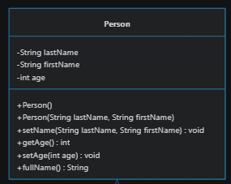
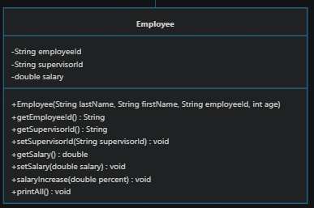
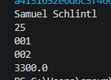

# INF - Aufgabe 1 - ReadMe für ITL12 erstellen

| | |
|---|---|
| Name | Samuel Schlintl |
| Klasse | 2aAPC |
| Datum | 24.11.2026 |

## 1. Ziel

Das Ziel dieser Aufgabe war: Vererbung in
Java kennenzulernen und anzuwenden. Dazu musste eine
Basisklasse Person und eine davon abgeleitete Klasse Employee
erstellt werden.

## 2. Planung

## 3. Umsetzung

- Basisklasse Person erstellen
- Abgeleitete Klasse Employee erstellen
- Abruf der Konstruktors der Basisklasse
- Überprüfung von ungültigen Eingabewerten
- Erstellung einer Main Klasse

### Programmausgabe

## 5. Reflexion

### 1. Warum sind die Eigenschaften "private"?

Durch private wird verhindert das Eigenschaften von außerhalb verändert werden.

Dadurch können Eingabewerte überprüft und ungültige werden um ungültige Eingaben zu vermeiden. (= Kapselung)

### 2. Wann ist "protected" sinnvoll?

Wenn man eine Eigenschaft innerhalb einer Klasse verwenden will.

### 3. Was passiert ohne "super(...)"?

Wenn man den weglässt versucht Java automatisch den parameterlosen Konstruktor
der Basisklasse aufzurufen.

Da die Klasse Person einen parameterlosen Konstruktor
hat gibt es in diesem Fall keinen Kompilierungsfehler. Aber der Name wird nicht mit den Parametern initialisiert.

## 7. Quellen und Hilfsmittel

- Aufgabenstellung ITL1 Vererbung
- ChatGPT – Unterstützung bei Dokumentation und Erklärung
